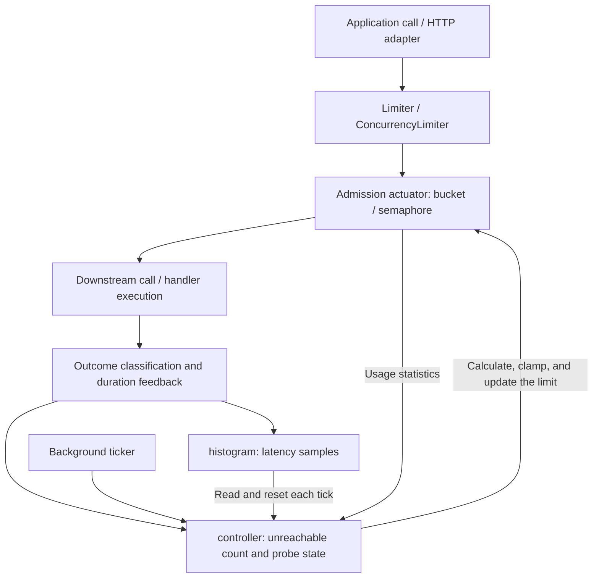

# Adaptive Rate and Concurrency Limiting Design

This document describes agilelimiter's current implementation, component boundaries, and main design trade-offs. See the [README](../README.md) for usage examples and [httpclient](../httpclient/httpclient.go) and [httpserver](../httpserver/httpserver.go) for protocol adapter implementations.

## 1. Goals and Scope

agilelimiter periodically adjusts request admission based on latency feedback, balancing throughput and latency within configured bounds.

| Mode | Public type | Protected resource | Control unit | Admission behavior |
|---|---|---|---|---|
| Outbound rate limiting | `Limiter` | Downstream dependency | Requests per second | Blocks until the scheduled grant time |
| Inbound concurrency limiting | `ConcurrencyLimiter` | Local service | Concurrent requests | Rejects immediately when no slot is available |

Both modes share a controller and use a leaky bucket and a nonblocking semaphore, respectively, to enforce admission. Rate limiting controls the interval between outgoing requests. Concurrency limiting bounds in-flight requests to prevent concurrency from accumulating as processing time increases.

The scope is a single process. Multiple instances observe and adjust their limits independently, without coordinating a global quota. The project does not provide distributed rate limiting, an inbound waiting queue, or a circuit breaker that stops all calls. It also does not guarantee a strict SLO compliance ratio.

## 2. Architecture

### 2.1 Component Responsibilities and Dependencies

| Component | Implementation | Responsibility |
|---|---|---|
| Protocol adapters | [httpclient/httpclient.go](../httpclient/httpclient.go), [httpserver/httpserver.go](../httpserver/httpserver.go) | Apply admission, measure protocol operation duration, and translate responses or errors into observations |
| Public API and object assembly | [limiter.go](../limiter.go), [concurrency.go](../concurrency.go) | Resolve configuration, assemble the histogram, controller, and actuator, and manage the lifecycle |
| Histogram | [histogram.go](../histogram.go) | Aggregate duration samples and produce per-tick quantiles, sample counts, and threshold exceedance counts |
| Controller | [controller.go](../controller.go) | Maintain the baseline and control state, and calculate and clamp the target limit |
| Outbound actuator | [bucket.go](../bucket.go) | Convert the target rate into a grant interval and block until admission |
| Inbound actuator | [semaphore.go](../semaphore.go) | Acquire and release slots under the target concurrency limit, rejecting without blocking when full |

Protocol adapters depend on the root package's public API. The core controller has no dependency on HTTP status codes or response structures. `Limiter` and `ConcurrencyLimiter` inject an actuator update function into the controller, which applies the new limit through `setRate func(int)`.

`ConcurrencyConfig.toConfig()` maps concurrency bounds to the rate fields of the internal `Config`, reusing defaults, validation, and the control algorithm. Consequently, in concurrency mode, the internal `rate`, `Stats.Rate`, and the `*Rate` fields of `Resolved` represent concurrency counts rather than request rates.



### 2.2 Request Path

Outbound `Limiter.Do()` executes the following sequence:

1. Call `Take()` and wait for the leaky bucket to grant admission.
2. Start timing and execute one synchronous application call.
3. Classify and report the outcome, then return the application error.

Inbound `ConcurrencyLimiter.Do()` first attempts to acquire a concurrency slot. On failure, it returns `ErrOverloaded` without executing the callback. On success, it times the operation, executes the callback, reports the outcome, and releases the slot through `defer`. A panic in the callback still releases the slot, but skips the subsequent outcome reporting.

When using `TryTake()` manually, each successful acquisition must be paired with exactly one `Release()`. The HTTP server adapter follows the same admission and release rules. Requests rejected by the limiter do not become handler-duration samples.

### 2.3 Background Control Path

`New()` and `NewConcurrency()` only construct objects. `Start()` launches a background goroutine in which a `time.Ticker` calls `controller.step()` at the configured `Tick` interval. The request path handles admission and records observations; the background path aggregates them and makes control decisions, avoiding control calculations on every request.

## 3. Observation Model

### 3.1 Duration Measurement

Controller input should represent the duration of the protected operation itself. Outbound measurements run from the actual start of a call to its return; inbound measurements cover the processing time of an admitted request. Outbound admission wait must be excluded from the control signal. Otherwise, additional waiting caused by a lower rate could be misinterpreted as further downstream slowdown.

```go
started := time.Now() // Choose the end-to-end metric's start for the application.
lim.Take()
sent := time.Now()
err := callDownstream()
finished := time.Now()

lim.ObserveOutcome(finished.Sub(sent), err) // Control signal.
endToEnd := finished.Sub(started)           // Includes this admission wait.
_ = endToEnd                               // Record through application metrics.
```

`Take()` returns the scheduled grant time, not the time before admission waiting began. Measuring from that return value excludes part of the admission wait and does not automatically eliminate coordinated omission. When slow requests occupy a fixed worker pool, requests that were never sent produce no samples. To evaluate latency against an external arrival schedule, the application or load generator must independently record the arrival schedule and waiting time.

The HTTP client adapter measures the underlying `RoundTrip()` duration, excluding subsequent response-body reads. The server adapter measures the duration of `ServeHTTP()` until it returns. Long-lived connections and streaming responses have different duration semantics from ordinary short requests and require separate budgets or observation policies.

Each sample should correspond to one actual attempt. Apply admission and report feedback for every retry rather than recording the combined duration of several attempts as one call. Classify cache hits, health checks, local rejections, and other outcomes that do not represent the target resource's capacity before reporting them. Operations with different latency distributions should generally use separate limiter instances.

### 3.2 Outcome Classification

`Outcome` describes what a result means to the controller, rather than whether the application operation succeeded.

| Outcome | Feedback behavior | Typical meaning |
|---|---|---|
| `Reached` | Clear probe state and record the actual duration | A meaningful call duration is available, including some errors and timeouts |
| `Unreachable` | Call `Unavailable()`, increment the unreachable count, and enter probe state | Connection failure, an open circuit breaker, or an adapter-classified unavailable response |
| `Aborted` | Usually do not record a duration | Cache hit, invalid observation, or caller cancellation |

The generic `Do()` and `ObserveOutcome()` paths call `Config.Classify` only for non-nil errors. By default, `context.Canceled` is classified as `Aborted`; other results are classified as `Reached`, including `context.DeadlineExceeded`. A custom classifier can override the default error classification.

The duration of a canceled request is a lower bound on its complete duration. `ObserveTruncated(d)` records that lower bound only when `SLOTarget` is configured and `d > SLOTarget`, preserving slow requests that have already exceeded the target. It does not clear probe state. The generic path applies this treatment to cancellation errors classified as `Aborted`; HTTP adapters handle cancellation before invoking a custom `Verdict`.

HTTP adapters use a separate `Verdict`, customized through `WithVerdict`, and do not invoke `Config.Classify`:

- The client defaults to `Unreachable` for connection-establishment `net.OpError` errors, HTTP 429, and all 5xx responses, and to `Aborted` for recognized cache hits.
- The server defaults to `Unreachable` for HTTP 429, 502, 503, and 504, and to `Aborted` for other 4xx responses and cache hits. HTTP 500 retains its actual processing duration by default.

These policies belong to the adapter layer. The core controller does not infer whether a particular error or status code indicates insufficient capacity.

### 3.3 Per-Tick Statistics and Precision

`histogram` is a fixed-size logarithmic histogram with 256 buckets and four sub-buckets per factor-of-two range. Recording uses atomic counters. A snapshot reads and resets each bucket to calculate `p50`, `p99`, the sample count `n`, and the tail-threshold exceedance count `above`. It covers samples between successive snapshots rather than maintaining a sliding window across multiple ticks.

Quantiles use nearest-rank selection, `ceil(q × n)`, and return the selected bucket's lower bound. This introduces downward quantization error, approximately no more than 20% in the normal range. Tail counting includes only buckets whose lower bound is strictly above the threshold. The bucket containing the threshold is excluded, which can underestimate exceedances.

Snapshots can run concurrently with recording, but per-bucket exchanges do not form a globally atomic snapshot, so tick boundaries are approximate. These statistics support feedback control and should not replace precise SLO reporting.

## 4. Control Algorithm

The following sections use `R` for the target limit: requests per second in outbound mode and concurrent requests in inbound mode. The controller retains a floating-point value internally and rounds it to an integer before updating the actuator.

### 4.1 Tick Processing Order

`controller.step()` performs the following sequence under a mutex:

1. Determine whether the tick is an outage based on the unreachable count and add one synthetic sample if needed.
2. Read and reset the histogram and usage statistics, and update the tick's observation metrics.
3. Return without changing the limit if there are no samples. On the first nonempty tick, initialize the baseline and return.
4. Update the latency baseline, calculate the control window, and determine an adjustment factor from the median.
5. Apply tail protection and outage backoff, clamp the limit, and update the actuator.

Empty ticks neither reset the median hysteresis counters nor update the smoothed tail ratio. The first nonempty tick may include a synthetic sample; it still initializes the baseline without adjusting the limit.

### 4.2 Latency Baseline

The current tick's `p50` is used directly as the primary signal and stored in `Stats.Fast`. There is no separate fast EWMA. The baseline `B` uses an asymmetric exponentially weighted moving average:

```text
alpha(H) = 1 - 2^(-Tick / H)

if p50 < B:
    B ← B + alpha(SlowDownHalfLife) × (p50 - B)
else:
    delta ← min(alpha(SlowHalfLife) × (p50 - B), B × MaxBaselineRise)
    B ← B + delta
```

Defaults are `SlowHalfLife = 45s`, `SlowDownHalfLife = SlowHalfLife / 9`, and `MaxBaselineRise = 0.002`. The baseline follows improvements more quickly and absorbs sustained slowdowns gradually, limiting how much congestion can raise the baseline. It is not a historical minimum. The implementation provides neither an explicit baseline-reset API nor periodic load-reduction probes.

### 4.3 Control Window and Anchors

The window's upper bound is `high`; its lower bound is `low = high × (1 - Deadband)`, with `Deadband = 0.05` by default.

| Anchor | Window upper bound |
|---|---|
| `AnchorBaseline`, no SLO | `B × (1 + TargetInflation)` |
| `AnchorBaseline`, with an SLO | `min(B × (1 + TargetInflation), 0.8 × SLOTarget)` |
| `AnchorSLO`, with an SLO | `0.8 × SLOTarget` |

The baseline anchor backs off on relative latency changes and does not require an SLO. However, it may interpret sustained slowdowns caused by external factors, such as a network path change, as congestion. The SLO anchor allows latency to vary within a fixed target window, but does not identify a capacity knee below that window. The baseline is still maintained under the SLO anchor for observability and synthetic outage samples.

If `AnchorSLO` is requested without `SLOTarget`, runtime behavior falls back to the baseline anchor. `Validate()` can report this configuration problem, and `Config()` exposes the fallback.

### 4.4 Median Decisions, Slow Start, and Usage Constraints

| Condition | Behavior |
|---|---|
| `p50 >= high` | Increment the high-latency counter and reset the low-latency counter; set the adjustment factor to `1 - DownStep` when `BackoffTicks` is reached |
| `p50 <= low` | Increment the low-latency counter and reset the high-latency counter; check usage and attempt growth when `RecoverTicks` is reached |
| `low < p50 < high` | Reset both counters and hold the limit |

The corresponding counter is reset after its action. Counters operate on ticks with samples; see §4.1 for empty-tick behavior. Default `BackoffTicks/RecoverTicks` values are `1/1` for the baseline anchor and `2/2` for an effective SLO anchor. Presets or explicit configuration can override them.

When growth conditions are met, usage is checked first. If usage is known and `Used × 2 < R`, the controller holds the limit rather than continuing to raise an admission ceiling that traffic has not exercised:

- Outbound usage is the number of calls entering `Take()` during the tick divided by `Tick`, including calls still waiting for admission.
- Inbound usage is the tick's peak in-flight count. A new tick starts from the current in-flight count, so requests spanning ticks continue to count.
- If no usage is counted, usage is treated as unknown and does not block growth, as with a path that only calls `Observe()`.

When growth is permitted, slow start uses `SlowStartGain`, a factor of 2 by default. Subsequent growth uses `1 + UpStep`, a factor of 1.05 by default. Slow start ends on the first median backoff, tail backoff, outage backoff, or when the maximum limit is reached. It does not restart during recovery. Setting `SlowStartGain = 1` disables doubling.

Normal growth and backoff are proportional to the current limit, rather than fixed additive increments. The default backoff factor is `1 - DownStep = 0.70`. There is no separate symmetric per-tick change cap.

### 4.5 Tail-Latency Protection

Setting `SLOTarget` enables tail protection with threshold `T = SLOTarget × TailFactor`; the default is `TailFactor = 1`. It changes only the tail threshold, not the median control window.

A resolved `TailTolerance = 0` selects quantile mode, where `p99 > T` triggers backoff. `TailTolerance > 0` selects ratio mode. Let `tol` denote the tolerated fraction:

```text
alpha = 1 - 2^(-1/2)                      // Half-life of two ticks.
ratio = above / n
smoothed ← smoothed + alpha × (ratio - smoothed)
sigma = sqrt(tol × (1 - tol) / n) × sqrt(alpha / (2 - alpha))
threshold = tol + 3 × sigma

Trigger when smoothed > threshold and ratio > tol.
```

The statistical margin is estimated from the current sample count. Fewer samples produce a wider threshold to reduce backoffs caused by sampling variation. Requiring the current ratio to exceed tolerance prevents continued backoff solely because the smoothed value remains elevated. This approximate statistical rule does not guarantee long-window SLO compliance.

Tail protection and outage backoff do not wait for `BackoffTicks`. When triggered, they cap the adjustment factor at `1 - DownStep`. Multiple backoff conditions do not multiply their reductions together.

## 5. Failure and Recovery

### 5.1 Outage Detection and Synthetic Samples

`Unavailable()` increments the unreachable count and immediately sets probe state, without directly changing the limit. At the start of a control tick, if unreachable records exist and their count is at least twice the current `hist.total`, the controller attempts to construct a synthetic sample and marks the tick as an outage when it can do so. Concurrent reads of these counters provide a per-tick approximation rather than a strictly synchronized application error ratio.

The synthetic duration is constructed as follows:

- With an SLO: `1.5 × max(SLOTarget, B)`.
- Without an SLO, after baseline initialization: `1.5 × B × (1 + TargetInflation)`.
- Without an SLO or an initialized baseline: no sample can be constructed, so outage backoff is not applied.

At most one synthetic sample is added per outage tick, with backoff applied directly. The sample preserves control input during an outage; it is not a measured latency, and its count does not scale with unreachable calls to inflate the tail-exceedance ratio. A small minority of unreachable calls adds no synthetic sample and forces no outage backoff.

### 5.2 Floor Selection and Limit Clamping

Normal state uses `FloorRate`; probe state uses `ProbeRate`. Concurrency mode uses the corresponding `FloorLimit` and `ProbeLimit`. The final control update is:

```text
floor = probe ? ProbeRate : FloorRate
R ← clamp(R × factor, floor, MaxRate)
```

An ordinary `Observe()` or a `Reached` outcome clears probe state, restoring the normal floor constraint on a subsequent control update. `Aborted` and `ObserveTruncated()` do not clear probe state. Changing floors does not immediately update the actuator. Outage detection determines whether to back off, while the current probe state determines which lower bound applies.

The default probe limit is at least 1, preserving an opportunity to observe recovery. The normal floor reflects the caller's estimate of safe capacity. Persistent timeouts that are not classified as unreachable remain subject to that floor; if actual capacity falls below it, the limiter cannot reduce the limit further.

## 6. Configuration and Runtime Behavior

### 6.1 Configuration Resolution

Construction first calls `applyPreset()`, then `withDefaults()` to fill defaults and repair some conflicts. The table below describes policies for fields left unset:

| Preset | Anchor | BackoffTicks / RecoverTicks | TargetInflation | TailTolerance |
|---|---|---|---|---|
| `PresetNone`, no SLO | Baseline | 1 / 1 | 1.0 | 0; tail protection disabled |
| `PresetNone`, with an SLO | SLO | 2 / 2 | 1.0 | 0.05 |
| `PresetBalanced` | Baseline | 1 / 1 | 1.0 | 0; quantile mode |
| `PresetLatencyFirst` | SLO | 2 / 2 | 1.0 | 0; quantile mode |
| `PresetThroughputFirst` | Baseline | 2 / 1 | 2.5 | 0; quantile mode |

Tail protection always requires `SLOTarget > 0`. Presets fill fields according to each field's unset-value rules. Explicit positive tuning values and explicit anchors take precedence; zero usually requests the default. For example, with `PresetNone` and an SLO, `TailTolerance = 0` resolves to 0.05 and cannot force quantile mode.

For bounds, `MinRate` defaults to 1, and unset `FloorRate` and `ProbeRate` inherit `MinRate`. `InitialRate` defaults to integer `MaxRate / 8`, then is clamped between the normal floor and the maximum. The default control interval is `Tick = 1s`; other control parameters are described in §4. Concurrency configuration follows the same resolution rules.

`New()` neither calls `Validate()` automatically nor returns configuration errors. Callers requiring strict validation must invoke it before construction. Some conflicts change the effective ceiling: for example, `MaxRate = 100, FloorRate = 200` raises the effective `MaxRate` to 200. Inspect the `Resolved` value returned by `Config()` for the final configuration, window, and tail policy.

### 6.2 Actuators and Concurrency Boundaries

The leaky bucket calculates the grant interval as `1s / rate`. The first call is admitted immediately. Later grants are scheduled relative to the previous grant time; after an idle period, the schedule aligns with the current time without accumulating burst allowance. Rate updates change intervals read subsequently, without resetting the existing time state or interrupting the current wait.

The semaphore acquires slots through atomic compare-and-swap and releases them through atomic subtraction. Lowering the concurrency limit does not cancel admitted requests. The in-flight count may temporarily exceed the new limit; admission resumes once existing requests drain sufficiently.

A mutex protects controller state updates and statistics reads. The histogram, usage counters, and semaphore use atomic operations. The leaky bucket waits while holding its mutex, and `Observe()` also acquires the controller mutex to clear probe state. The overall request path is therefore not lock-free. Allocation-free behavior is checked by the corresponding tests and does not imply lock-free or nonblocking execution.

The maximum-limit constraint resides in the controller. `bucket.setRate()` and `semaphore.setLimit()` enforce only a minimum of 1; neither independently stores or checks the configured ceiling. The current implementation therefore has no second actuator-level maximum check. Bounds apply to resolved configuration and should not be described as preserving the caller's original ceiling under every configuration.

### 6.3 Lifecycle and Observability

`Start()` and `Stop()` each use `sync.Once` so repeated calls do not start additional loops or close the stop channel more than once. `Stop()` waits for the background loop to exit. A stopped instance cannot be restarted; stopping neither cancels admitted application requests nor interrupts `Take()` waits. The owning service should manage the lifecycle centrally.

`Clock` controls core call timing and leaky-bucket waiting. The background ticker still uses real time. Virtual-clock tests advance the controller by invoking control steps directly rather than replacing the background ticker.

Key observation fields are:

| API or field | Meaning |
|---|---|
| `Rate()` / `Limit()`, `InFlight()` | Current target rate or actuator concurrency limit, and actual in-flight count; `Rate()` may be fractional |
| `Stats.Samples`, `P50`, `P99` | Sample count and approximate quantiles read by the most recent control step; an outage tick may include a synthetic sample |
| `Stats.Baseline`, `Fast` | Smoothed baseline and median of the most recent nonempty tick |
| `Stats.TailRatio`, `TailThreshold` | Smoothed exceedance ratio and trigger threshold in ratio mode |
| `Stats.ColdStart`, `Used` | Slow-start state and usage in the most recent tick |
| `Config()` | Resolved bounds, control parameters, and effective policy |

On empty ticks, `Samples/P50/P99` are zero, while the baseline and some control state are retained. Persistent empty ticks indicate a lack of evidence for adjustment; an unchanged limit alone does not establish stability. HTTP `StatsHandler` exposes a subset of state as JSON. Mount it outside the admission middleware so it remains accessible during overload.

## 7. Design Trade-offs and Known Limitations

| Decision | Rationale | Cost or boundary |
|---|---|---|
| Shared controller, separate actuators | Both modes translate latency feedback into scalar limit updates | Protected resources, units, and usage semantics differ; configuration cannot be copied directly between modes |
| Nonblocking inbound admission | Avoid retaining resources for overloaded requests waiting inside the limiter | Callers must handle rejection; HTTP returns 429 by default |
| Asymmetric baseline updates with capped increases | Limit how far sustained congestion can raise the relative window | Genuine long-term latency changes take longer to absorb |
| Doubling during slow start, small proportional growth during recovery | Shorten initial exploration while reducing renewed overshoot during recovery | Recovery after a deep reduction can be slow |
| Ratio-based tail protection | Tolerate a small fixed slow population and reduce sensitivity to per-tick quantile variation | Excess fast samples dilute the exceedance ratio; small sample counts produce wider statistical margins |
| Outcome classification at integration boundaries | Application and protocol layers have the context to judge whether a sample represents resource capacity | Default policies cannot cover all cache, fallback, and retry semantics |

Latency alone cannot distinguish queueing, network changes, inherently slow operations, and local overhead. Instance boundaries and sample classification directly affect control behavior. Tail tolerance does not replace filtering invalid fast samples.

Periodic control introduces sampling and feedback lag. Changing `Tick` changes both the number of adjustments per unit time and the baseline rise cap per tick, so it should be validated together with growth, backoff, and half-life parameters. `Take()` currently accepts no context, so cancellation cannot end its wait early. Streaming operations, global quotas, and stopping probes entirely require separate handling.

## 8. Validation and Maintenance Entry Points

| Validation area | Code entry points |
|---|---|
| Grant pacing, rate changes, growth, and backoff | [limiter_test.go](../limiter_test.go), [concurrency_test.go](../concurrency_test.go) |
| Anchors, hysteresis, slow start, and configuration resolution | [anchor_test.go](../anchor_test.go), [slowstart_test.go](../slowstart_test.go), [config_test.go](../config_test.go) |
| Outages, cancellation, floor transitions, and recovery | [outage_test.go](../outage_test.go), [refused_diag_test.go](../refused_diag_test.go), [floor_probe_test.go](../floor_probe_test.go), [concurrency_probe_test.go](../concurrency_probe_test.go) |
| Bounds under random inputs and statistical precision | [properties_test.go](../properties_test.go) |
| Protocol classification, admission rejection, and resource release | [httpclient/httpclient_test.go](../httpclient/httpclient_test.go), [httpserver/httpserver_test.go](../httpserver/httpserver_test.go) |
| Lifecycle and statistics output | [observability_test.go](../observability_test.go) |
| Hot-path allocations and benchmarks | [bench_test.go](../bench_test.go) and benchmarks in both HTTP packages |
| Capacity changes, sample contamination, and mixed traffic | [sim/](../sim/) |

Core tests use a custom fake clock and drive control steps directly. `sim/` uses the internal [simhook](../internal/simhook/simhook.go) to advance the controller and inject modeled usage, without waiting for simulated time to elapse in real time. The main module depends only on the Go standard library.

Run from the repository root:

```bash
go test ./...                    # Complete main-module test suite.
go test -short ./...             # Skip some long-running simulations.
go test -race ./...               # Race detection; long simulations cost more.
go test -run '^TestAdvantage' -v ./sim
```

[compare/](../compare/) is a separate Go module containing real-clock comparative experiments and diagnostic tests. It is not covered by `go test ./...` from the repository root. Historical results are documented in [RESULTS.md](../compare/RESULTS.md) and [ADVANTAGE.md](../compare/ADVANTAGE.md). Some measurements come from older controller versions and should not be treated as performance guarantees for the current implementation. Evaluations should record the version, model, configuration, and measurement definitions, and consider throughput completed within the SLO (goodput), overload duration, and recovery time together.
