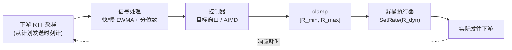

# 单进程出站自适应限流器设计

**目标**：保护下游依赖。用低开销、可预测的方式把发往下游的速率压到"下游还能健康服务"的水平，同时保留一个**可承诺的静态硬上限**。

**约束（已确认）**

| 维度 | 选择 | 带来的设计后果 |
|---|---|---|
| 作用方向 | 出站，保护下游 | 信号取下游 RTT；控制器感知的是**下游**的健康，不是本机负载 |
| 作用范围 | 单进程/单机 | 无跨节点协调；每个副本各自自适应，全局总量 = 副本数 × 单机值 |
| 观测信号 | 下游 RTT / 服务端耗时；从计划发送时刻计时 | 见 §2 的测量纪律 |
| 硬上限 | 需要 | 静态 ceiling 独立于控制器强制生效 |

---

## 1. 核心思路：分层——漏桶当执行器，反馈当设定点

漏桶擅长的是**"给定速率下，精确、平滑、低开销地放行"**；它不擅长**"决定速率应该是多少"**。把这两件事拆开，各用各的长处：



- **执行层（actuator）** = 现有的 leaky bucket，速率设为 `R_dyn`。它把"要发多快"变成精确、平滑的节拍。
- **决策层（controller）** = 反馈模型，根据 RTT 信号输出 `R_dyn`。
- **硬上限** = `clamp(R_dyn, R_min, R_max)`，且**在 actuator 内部再兜一层**（见 §5）。控制器即便出 bug，也越不过 `R_max`。

这么做直接命中漏桶的两个痛点：**"速率该定多少"不再靠猜**（控制器给），**"对下游健康一无所知"被补上**（RTT 反馈）。而漏桶原本的优点——平滑、低开销、可预测——全部保留。

> 关键点：**别把漏桶换掉，把它降级成"执行器"来用。**

---

## 2. 测量：如何避免协调遗漏（Coordinated Omission）

这是整个方案最容易翻车的地方，先讲。

**问题**：如果你只测"请求实际发出 → 收到响应"的时间，那么当系统变慢时，你的发送循环也会跟着卡住、发得更少——于是**最慢的那段反而被采样得最少**，控制器看到的是"还行"，永远不降速，直到彻底崩溃。这就是协调遗漏。

**做法**：从**计划发送时刻**计时。这正是本库 `Take()` 返回计划发牌时刻的价值所在：

```go
t0    := rl.Take()          // 计划发送时刻（若被限流会阻塞到这里）
start := time.Now()         // 实际发出
resp, err := doRequest(ctx)
done  := time.Now()

downstreamRTT := done.Sub(start)  // ① 纯下游信号：实际发出→响应
coLatency     := done.Sub(t0)     // ② 用户体感：计划时刻→响应，含自身节流排队
```

**两个指标的用途要分清：**

- **驱动控制器用 ① `downstreamRTT`**。它是"下游自己花了多久"的干净信号。**不要拿 ② 喂控制器**——`coLatency` 里含着你自己的限流排队：你越是收紧速率，`coLatency` 越高，控制器就会进一步收紧……形成**自反馈跑飞**，一路掉到 `R_min`。这是 latency 驱动限流器最常见的死法之一。
- **② `coLatency` 只用于 SLO 观测/报表**，它才是用户真正体感、且 CO 安全的口径。

**采样纪律**（比公式更重要）：

1. **别让采样停摆**。如果发送由固定数量的 worker 驱动，下游一变慢 worker 就被占满、`Take()` 都调不到，此刻你其实已经"少发了"。要么保证持续按计划节奏投递，要么把这"本该发却没发"的 stall 按计划时刻计入——否则又是 CO。
2. 采样丢弃要计数（channel 满、背压），丢了多少心里要有数。

---

## 3. 控制器：快/慢 EWMA 基线对比 + 分位数

### 3.1 信号处理

对 `downstreamRTT` 维护几条统计量：

- **`fast`**：快速 EWMA（半衰期 ~2–5s），反映**当前**状况。
- **`slow`**：慢速 EWMA（半衰期 ~30–60s），作为**健康基线**。
- **分位数**：滑动窗口（~30–60s）的 `p50` 与 `p99`。用固定对数直方图（每周期原子桶计数后复位）即可，零分配。

**比较要"同类比同类"**，避免量纲错配：

- **控制器主信号**：`fast(p50)` vs `slow(p50)` —— 中位数抬升是**最干净的拥塞信号**。
- **p99 作守卫**：`p99` 用于尾延迟安全带，越过 SLO 时无论主信号如何，直接乘性下压。

### 3.2 调节律（本项目落地实现）

核心是一个**目标窗口 + AIMD**：

```text
high ← slow · (1 + TargetInflation)      // 可容忍的延迟上界
low  ← high · (1 - Deadband)             // 上界之下再留死区

若 fast ≤ low            → R_dyn ← min(R_dyn·(1+UpStep),  R_max)          // 健康：加性增（探测）
若 fast ≥ high           → R_dyn ← max(R_dyn·(1-Gain·excess/high), R_min)  // 拥塞：比例降，封顶 DownStep
否则（死区内）           → R_dyn 不变                                     // 保持
尾延迟守卫: 若 p99 > SLO → R_dyn ← max(R_dyn·(1-DownStep), R_min)         // 无视主信号，直接下压
```

`excess = (fast - high) / high`。**关键点**：不是拿 `fast` 和"空闲基线"直接比，而是允许延迟在基线之上抬升 `TargetInflation` 倍——**容忍一定排队**才不会一有排队就收手、把利用率压到极低。`TargetInflation = 1.0` 表示"容忍到 2× 基线"。这也正是 Netflix Gradient2 里 queue-size target 的思路。

**非对称是关键**：**降得快、升得慢**（乘性减 `DownStep=0.30`、加性增 `UpStep=0.05`）。既对下游友好（一旦苗头不对立刻收手），又能避免在拐点附近来回震荡时反复冲击下游。

**死区/迟滞**：`low < fast < high` 之间不动作，滤掉噪声导致的抖动。

> 备注：设计早期还考虑过纯梯度律 `R_dyn ← R_dyn·(slow/fast)^γ`，但它缺少"容忍排队"的目标点，容易在低利用率处锁死；最终采用上面的目标窗口律。

### 3.3 稳定性旋钮（按重要性）

1. **慢信号 / 长半衰期**——越慢越稳，但越滞后。这是"慢速 EWMA"的全部意义。
2. **单周期变化上限**——无论公式算出多少，每周期 `R_dyn` 变化不超过 ±x%（如 20%），防止阶跃。
3. **死区**（§3.2）。
4. **增益 `Gain` / 步长 `UpStep`·`DownStep`**——调大响应快但易振荡。

### 3.4 ⚠️ 最重要的一条：**基线不能被拥塞污染**

如果用 `slow` 当基线，而下游**长时间**处于拥塞，`slow` 会慢慢爬向拥塞值 → `slow/fast → 1` → 控制器**停止降速，卡在拥塞态出不来**。这是 latency 驱动控制器的头号暗坑。对策（至少做一条）：

- 基线取**低位分位数**或"近期最小值"的慢速平滑，而非均值/中位数——它代表"健康时的样子"。
- 限制基线每单位时间**向上的漂移速度**。
- **周期性向下探测**：偶尔小幅降速，看延迟是否随之改善，以验证"现在真的没余量"还是"基线被污染了"。
- 外部事件（发版、下游重启、错误率跳变）时**重置基线**。

---

## 4. 与现有代码的集成

### 4.1 执行器：给 `atomicInt64Limiter` 加 `SetRate`

现有 `limiter_atomic_int64.go` 里 `perRequest` 和 `maxSlack` 是普通字段。改成原子，运行时热更新：

```go
type adaptiveAtomicInt64 struct {
    prepadding  [64]byte
    state       int64 // 下次放行时刻（unix ns），与速率无关
    postpadding [56]byte
    perRequest  int64 // atomic ns
    maxSlack    int64 // atomic ns（负数）
    clock       Clock
}

func (t *adaptiveAtomicInt64) SetRate(rate int, per time.Duration, slack int) {
    pr := int64(per / time.Duration(rate))
    atomic.StoreInt64(&t.perRequest, pr)
    atomic.StoreInt64(&t.maxSlack, -int64(slack)*pr)
}
```

`Take()` 里把 `t.perRequest` / `t.maxSlack` 换成 `atomic.LoadInt64(...)` 即可。

**为什么改速率不会引起突发或卡顿**：`state` 存的是**绝对时刻**，与速率无关；改速率只影响下一次的**增量** `state + perRequest`。所以热更新**天然不重置状态**，是无缝的。（唯一提醒：自适应场景把 `slack` 设小——slack 的突发缓冲会削弱控制器对速率变化的响应锐度。）

### 4.2 包装与热路径

```go
type AdaptiveLimiter struct {
    inner *adaptiveAtomicInt64 // 执行器
    // 采样用原子/无锁，热路径零分配
    hist  *logHistogram        // 分位数（原子桶）
}

func (a *AdaptiveLimiter) Take() time.Time { return a.inner.Take() }

// 调用方在请求前后喂样本：
func (a *AdaptiveLimiter) Observe(rtt time.Duration) { a.hist.Record(rtt) }
```

### 4.3 控制循环

独立 ticker（如每 1s）跑控制逻辑，与热路径解耦：

```go
func (c *Controller) loop() {
    tk := time.NewTicker(c.tick)          // 1s
    for range tk.C {
        sig := c.hist.SnapshotAndReset()   // 取本周期 p50/p99（原子桶，复位）
        c.updateEWMA(sig)                  // fast / slow / 基线
        next := c.adjust()                 // §3.2 的梯度或 AIMD
        next = clamp(next, c.minR, c.maxR) // 硬上限（第一层）
        c.rate.Store(next)
        c.inner.SetRate(int(next), c.per, c.slack)
    }
}
```

热路径只做一次 `Record`（一个原子加），零锁零分配。

---

## 5. 硬上限与兜底（防御纵深）

硬上限要在**两层**独立生效，任何一层出问题都不会突破：

1. 控制器输出后 `clamp(R_dyn, R_min, R_max)`。
2. actuator 自身：即使被喂了超过 `R_max` 的速率，也不越界。

`R_max` 就是你要求承诺的那个静态值（合同/配额）。`R_min` 建议留一小股**探测流量**（不为 0），这样下游恢复时能立刻被感知。

**强烈建议再加一条错误/超时兜底**（即使你没勾这个信号）：RTT 只反映"慢"，不反映"贵"——下游**直接报错/超时**时，延迟样本可能看起来正常。连续超时 → 直接打到低位，这是安全阀，和延迟信号并行工作。

**冷启动**：没有基线时**从低速起步、慢慢爬升**（对下游友好），而不是从 `R_max` 往下退——后者在启动瞬间就可能压垮下游。

---

## 6. 陷阱清单（按踩坑概率排序）

1. **协调遗漏**——测量纪律，见 §2。
2. **基线被拥塞污染**——长时间过载后卡死，见 §3.4。
3. **自反馈跑飞**——把含自身节流的端到端延迟喂回控制器，见 §2。
4. **进入震荡**——调增益/死区/单步上限；用非对称（慢升快降）。
5. **快慢不匹配**——慢基线滞后，突发事件需要**快速信号**（如 p99 守卫、错误率）做安全阀。
6. **单信号局限**——RTT + 错误率一起看；只看 RTT 会漏掉"快速失败"。
7. **黑盒化**——必须暴露 `R_dyn / R_min / R_max / baseline / fast / p99 / 升降事件计数`。一个不可观测的自适应限流器，出事时无法复盘。

---

## 7. 验证方法

- **确定性单测**：本仓库已经依赖 `github.com/benbjohnson/clock`（mock 时钟）和 `go.uber.org/atomic`——直接拿来做无 flaky 的控制器测试。喂入**构造好的 RTT 序列**（健康→阶跃变慢→恢复），断言 `R_dyn` 的轨迹：能爬升、遇拥塞及时回退、永不超 `R_max`、恢复后能回升。
- **阶跃/混沌测试**：下游 RTT 突增，测量"多快回退到安全值"；恢复后测量"多快爬回 `R_max`"。
- **不变量测试**：任意序列下 `R_min ≤ R_dyn ≤ R_max` 恒成立。
- **CO 验证**：构造"下游变慢导致采样变少"的场景，确认控制器**仍然**能降速。

---

## 8. 一句话总结

**把 `R_dyn` 交给 `Take()` 之外的另一个循环来计算，让漏桶只负责按这个速率平滑放行。** 决策来自"快 EWMA 对比慢 EWMA 基线"（配 p99 守卫、错误兜底），执行复用手上的 leaky bucket，硬上限在控制器和执行器两层强制。测量是一切的地基——**必须从计划发送时刻计时，且采样不能在变慢时停摆**。

## 9. 锚点：相对基线 vs 绝对 SLO（实现补充）

对应代码里的 `Config.Anchor` 与 `Config.BackoffTicks` / `RecoverTicks`。

### 9.1 相对锚点的固有缺陷

阈值 `high = slow·(1+TargetInflation)`，再取 `min(high, 0.8·SLO)`。
注意 `min()` 是**单向**的：SLO 只能把窗口压低，永远不能抬高。
所以基线一小、SLO 一宽松，SLO 就完全不参与决策，实际目标变成
“最快观测延迟的 2 倍”：

```text
baseline 20ms, SLO 200ms  ->  high = min(40ms, 160ms) = 40ms
```

### 9.2 病态表现：健康但变慢，也会掉到地板

20ms → 50ms（只占 SLO 的 1/4，但已是 2.5× 基线）→ 判为拥塞 → 每拍 -30% → 打到
`MinRate`。而且很难自己爬出来：基线只能按 `MaxBaselineRise`（默认 0.2%/拍，
约 12%/分钟）上浮，回升只能 `+UpStep`（5%/拍），`coldStart` 也不再重置。
虚拟时钟实测（`TestBaselineAnchorCollapsesOnBenignRise`）：500 → 10 req/s 用 26 拍，
回到 500 要 88 拍。

这类“外生变慢”在线上很常见：下游发版、网络路径变化、GC 参数调整、缓存变冷、
响应体变大。它们和排队的信号**完全一样**，区别只在于“压速到底有没有用”。

### 9.3 绝对锚点

`AnchorSLO`：`high = 0.8·SLOTarget`，与基线无关。基线仍然维护（`Stats`、
`outageSample` 还在用），但不再决定降速；p99 尾延迟守卫保留。

代价：SLO 有富余时会一直往上探，找不到低于 SLO 的拐点。适用于“下游有明确延迟
目标、且在目标内能优雅退化”的场景。

实测（`compare`，20ms → 70ms，SLO 100ms，容量 150/s，跑 20s）：

| | 完成/s | 满足 SLO/s | 最终速率 |
|---|---:|---:|---:|
| uber 固定 100/s | 102 | 102 | 100 |
| 相对锚点 2×（默认） | 48 | 48 | **5** |
| 相对锚点 3.5× | 99 | 99 | 112 |
| 绝对锚点 `AnchorSLO` | 99 | 99 | 109 |

容量真掉（150→40/s）时反过来：固定速率没有任何防御（均值 619ms，仅 40% 达标），
绝对锚点收在 ~39/s、83% 达标。

### 9.4 时间迟滞

`BackoffTicks` / `RecoverTicks`：连续 N 拍同侧才动作（CoDel 的 interval 简化版）。
默认 `AnchorBaseline` 1/1（保持原行为），`AnchorSLO` 2/2。

为什么不能只靠 EWMA 平滑：步长不对称（-30% / +5%），噪声不会相互抵消，
而是把速率**棘轮式**往下拽。死区内的一拍会同时清零两个计数器，
所以要求的是“连续”而不是“累计”。

### 9.5 选型

| 你的处境 | 建议 |
|---|---|
| 下游是自己可控的服务、有明确 SLO | `AnchorSLO` |
| 下游在 SLO 之前就有明显拐点 | `AnchorBaseline`，并把 `MaxRate` 设在拐点 |
| 信号噪声大（低流量、样本少） | 两种锚点都配 `BackoffTicks >= 2` |

### 9.6 快速恢复（`RecoverRamp`）

问题：`coldStart` 用过就不重置，深跌后只能 `+UpStep`。5 → 120 要
`ln(24)/ln(1.05) ≈ 65` 拍，而跌下去只用了十来个拍——**恢复比故障本身还慢**。
多场景矩阵里，这是自适应方案唯一输给固定速率的地方。

做法：给乘性探测加第二个触发条件——观测延迟 ≤ 容忍窗口的一半（`RecoverRamp`，
默认 0.5）。此时下游离拐点还很远，信号没有歧义，倍增最多多花两拍
（`DownStep=0.30`）；一旦延迟回到窗口内，立即退回 `+UpStep`。所以 AIMD 的
保守性只在“贴着拐点”时才生效，而不是永久关闭快速回升。

这不是“重新开慢启动”：贴着拐点探测的限流器永远不会“比窗口还低一半”，
所以真正需要谨慎的那段探测仍然由 AIMD 管。

### 9.6 快速恢复（`RecoverRamp`，默认关闭）

问题：`coldStart` 用过就不重置，深跌后只能 `+UpStep`。5 → 120 要
`ln(24)/ln(1.05) ≈ 65` 拍，而跌下去只用了十来个拍——**恢复比故障本身还慢**。
多场景矩阵里，这是自适应方案唯一输给固定速率的地方（容量 40 → 150/s 时，
自适应 25，uber(140) 98）。

做法：给乘性探测加第二个触发条件——观测延迟 ≤ 容忍窗口的一半（`RecoverRamp`
取 0.5 开启）。此时下游离拐点还很远，倍增最多多花两拍（`DownStep=0.30`）；
一旦延迟回到窗口内，立即退回 `+UpStep`。

**为什么默认关闭（0）**：倍增也是越界的来源。矩阵实测（2× 锚点，2 轮均值）：

| 场景 | 关闭 | 开启 0.5 |
|---|---:|---:|
| 3 容量跌 150→40/s | 59 | 46 |
| 4 容量恢复 40→150/s | 25 | 52 |

恢复赢了 27，容量下跌输了 13：刀锋型容量曲线下 2 倍过冲会把延迟直接顶到 1s，
而 AIMD 的小步长恰恰擅长贴着这种拐点。所以这条留给“下游会优雅退化、更可能
恢复而不是继续恶化”的场景。

### 9.7 预设与配置可见性

20 个字段里有 17 个有默认值，但“有默认值”不等于“用户知道它被怎么设的”。
所以补了四件事：

- **`Config.Preset`**：把策略类字段（`Anchor` / `BackoffTicks` / `RecoverTicks` /
  `TargetInflation`）折进三个命名预设，只填空值，显式值优先。预设之间最多差
  3~4 个字段——差得更多就不叫预设，叫另一台机器。
- **不推导 `Tick` 与半衰期**：它们规定的是控制律的时间尺度。改 `Tick` 等于把所有
  “每拍”的增益重新标定一遍，静默推导会让用户以为只改了一个数。
- **`Config.Validate()`**：把以前 8 条静默修复改成可显式拒绝（`MinRate > MaxRate`、
  `AnchorSLO` 无 `SLOTarget`、`Deadband >= 1` 等）。`New` 签名不变——库在升级时
  开始返回 error 会一次性打断所有调用方。
- **`Limiter.Config() → Resolved`**：打印解析后的完整配置，包括“要了 SLO 锚点但
  没给 SLO，实际跑的是相对锚点”这种情形。不能直接打印 `Config`，因为它带着
  两个函数字段。


## 10. 信号卫生：什么不该进入样本

§9 讨论的是“时长应该受哪套策略管”，本节讨论“这个时长到底有没有在测下游”。
控制器只有一个输入，也分不清有意义的样本和误导性的样本，所以
`compare/pollution_test.go` 把代价量了出来。所有对照组的下游都是**平的**
（延迟与速率无关），因此任何降速都必然是误判。

| 样本流 | 对照 | 污染后 | 发生了什么 |
|---|---:|---:|---|
| 80% 请求 1ms（缓存命中） | 135/s | 136/s | 无伤害：miss 路径压不饱和 |
| 5% 请求恒定 300ms | 136/s | **54/s** | 尾守卫把“固定的慢总体”读成拥塞 |
| 内部重试一次（样本 ×2） | 135/s | **24/s，0% 达标** | 绝对比较拿到的是两倍真实延迟 |
| 本地开销 +20ms（未越 `SLOTarget`） | 136/s | 136/s | 无伤害：窗口和信号一起平移 |
| 本地开销 +50ms（越过 `SLOTarget`） | 135/s | **24/s，0% 达标** | 同样的污染，这次触发了守卫 |

三条结论：

1. **相对窗口会自我校正，尾守卫不会。** 在每一个速率触底的场景里，中位数判决都是
   “健康”——常数偏移让 `fast` 和 `slow` 一起动，比值不变；而绝对比较会命中，
   并且一次就是 `-30%/拍` 一路砍到 `MinRate`。
2. **尾守卫比的是“单拍 p99 vs `SLOTarget`”。** SLO 是长窗口的比例（“99% 在
   200ms 内”），而单拍 p99 越过这个数，对一个“刚好达标”的服务是**常态**
   （大约一半的拍）。而一半的拍就足够把速率拖到地板（`0.70 × 1.05 < 1`）。实测：
   完全无排队的下游上，5% 请求恒定 300ms 就把 300 req/s 打成 21。
   这就是 `TailFactor` 存在的理由：它只移动守卫阈值，不动窗口天花板和 `AnchorSLO`
   的目标。默认 1.0（对着 SLO 开火，即历史行为），当长尾来自“不同请求类型”
   而不是“排队”时，建议设 1.5~2.0，而 `SLOTarget` 继续写契约上那个数。
3. **本地开销本身无害，越线才致命。** `+20ms` 零伤害，`+50ms` 从 300 掉到 5。

### 10.1 比例模式（`TailTolerance`）

上面的结论直接推出一个改法：既然问题在于“一个次序统计量 vs 一条绝对红线”，那就
换成“**这一拍有多少比例超线**”。`TailTolerance > 0` 时启用：

```go
ratio := above / n                      // 本拍超线比例
over  += α * (ratio - over)             // 半衰期 ~2 拍的 EWMA，滤掉单拍尖峰
if over > TailTolerance {
    factor = 1 - min(DownStep, Gain*(over-tol)/tol)   // 比例降，不是二值 −30%
}
```

实测（延迟与负载无关的下游，5% 请求恒定 300ms）：

| `TailTolerance` | 完成/s | 最终速率 |
|---|---:|---:|
| 0（p99 测试） | 54 | **21** |
| 0.05 | 44 | 15 |
| 0.10 | 136 | **300** |

而“每个请求都是 300ms”时，0.10 依然把速率打到 `MinRate`（25/s，0% 达标）——
**保护能力没丢，只是不再被单个样本触发**。

中间那行是个真实的教训：**容忍度恰好等于 cohort 占比不起作用**。每拍的比例是
采样统计量，会在 5% 上下抖动，一旦越过 0.05 就是 −30%，而恢复只有 +5%。经验值：
容忍度取 cohort 占比的 2 倍左右。

修法统一在接口层：**在样本进入 `Observe` 之前决定它代表什么**。

| 样本可能是 | 怎么办 |
|---|---|
| 缓存命中 / 健康检查 / 预检 | 判 `Aborted`，不进信号 |
| 另一个端点（有自己的延迟画像） | 单独一个 limiter，不要把两个总体平均进一个 p50 |
| 重试的一次尝试 | 用 `Take`/`Observe` 按单次尝试上报，不要用 `Do` |
| 本地开销（序列化、锁、GC） | 只测调用本身；注意它吃掉的是 SLO 余量 |
| 被**自己的** deadline 截断的尝试 | 保证 deadline > `SLOTarget`；短于它，样本被削平，限流器在 deadline 之上失明 |

---

## 参考

- Netflix `concurrency-limits`（Gradient / Vegas：短 RTT EWMA 对比长 RTT EWMA）
- TCP Vegas / BBR（延迟驱动的拥塞控制）
- AIMD（Jacobson 的 TCP 拥塞控制）
- CoDel（基于排队延迟的主动队列管理）
- Gil Tene — "How NOT to Measure Latency"（协调遗漏）
