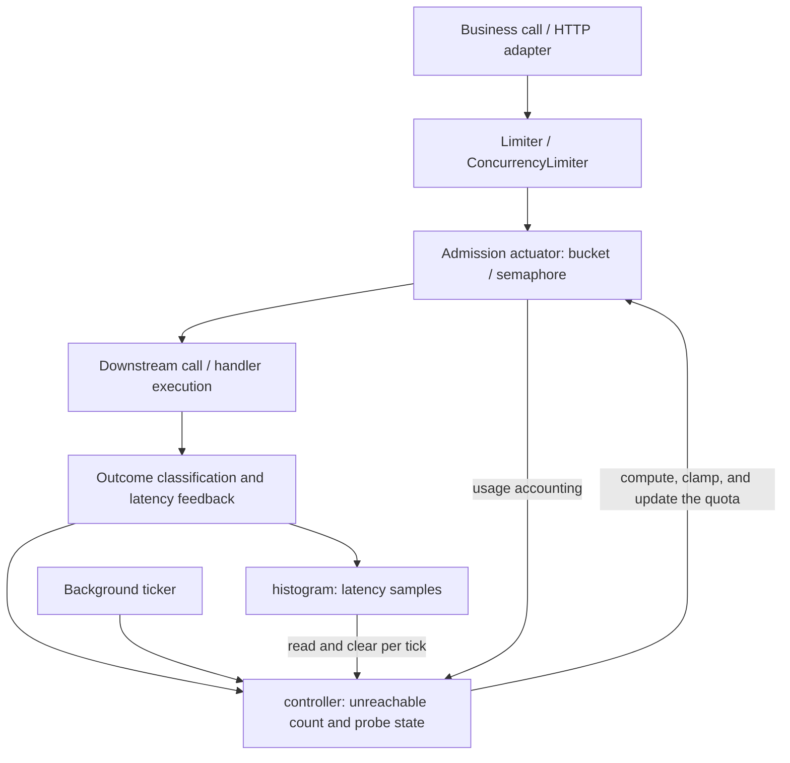

# Adaptive Rate and Concurrency Limiting Design

This document describes the current implementation, component boundaries, and main design trade-offs of agilelimiter. For usage examples, see [README](../README.md); for the protocol integration implementations, see [httpclient](../httpclient/httpclient.go) and [httpserver](../httpserver/httpserver.go).

## 1. Goals and Scope

agilelimiter periodically adjusts the request admission quota based on latency feedback, balancing throughput against latency within configured bounds.

| Mode | Public type | Protected target | Quota unit | Admission behavior |
|---|---|---|---|---|
| Outbound rate limiting | `Limiter` | Downstream dependency | Requests per second | Blocks until the release instant |
| Inbound concurrency limiting | `ConcurrencyLimiter` | The current service | Number of concurrently executing requests | Rejects immediately when no slot is available |

Both modes share the controller, but enforce admission with a leaky bucket and a non-blocking semaphore respectively. Rate limiting constrains the interval between sends; concurrency limiting constrains the number of in-flight requests, preventing concurrency from accumulating as processing time grows.

The scope is a single process. Multiple instances observe and adjust their quotas independently and do not coordinate a global budget. The project does not provide distributed rate limiting, an inbound wait queue, or a circuit breaker that stops calls entirely, nor does it guarantee a strict SLO attainment ratio.

## 2. Overall Architecture

### 2.1 Component Responsibilities and Dependencies

| Component | Implementation | Responsibility |
|---|---|---|
| Protocol adapters | [httpclient/httpclient.go](../httpclient/httpclient.go), [httpserver/httpserver.go](../httpserver/httpserver.go) | Enforce admission, measure protocol call latency, and convert responses or errors into observations |
| Public API and object assembly | [limiter.go](../limiter.go), [concurrency.go](../concurrency.go) | Process configuration, assemble the histogram, controller, and actuator, and manage the lifecycle |
| Histogram | [histogram.go](../histogram.go) | Aggregate latency samples and emit per-tick quantiles, sample counts, and over-threshold counts |
| Controller | [controller.go](../controller.go) | Maintain the baseline and control state, compute and clamp the target quota |
| Outbound actuator | [bucket.go](../bucket.go) | Convert the target rate into a send interval and block until release |
| Inbound actuator | [semaphore.go](../semaphore.go) | Acquire and release slots up to the target concurrency, rejecting without blocking when full |

The protocol adapters depend on the public interfaces provided by the root package; the core controller does not depend on HTTP status codes or response structures. `Limiter` and `ConcurrencyLimiter` inject an actuator update function into the controller and apply new quotas through `setRate func(int)`.

`ConcurrencyConfig.toConfig()` maps the concurrency bounds onto the rate fields of the internal `Config`, reusing the defaulting, validation, and control algorithm. Consequently, in concurrency mode the internal `rate`, `Stats.Rate`, and the `*Rate` fields of `Resolved` denote a concurrency count, not a request rate.



### 2.2 Request Path

The outbound `Limiter.Do()` executes in the following order:

1. Call `Take()` and wait for the leaky bucket to release.
2. Start timing and execute one business call synchronously.
3. Classify and report the outcome, then return the business error.

The inbound `ConcurrencyLimiter.Do()` first attempts to acquire a concurrency slot. On failure it returns `ErrOverloaded` without executing the callback; on success it starts timing, executes the business call, reports the outcome, and releases the slot with `defer`. If the callback panics, the slot is still released, but the subsequent outcome feedback is not executed.

When calling `TryTake()` manually, each successful acquisition must be matched by exactly one `Release()`. The HTTP server adapter follows the same admission and release rules; requests rejected by the limiter are not recorded as handler latency samples.

### 2.3 Background Control Path

`New()` and `NewConcurrency()` only construct objects. `Start()` launches the background goroutine, and a `time.Ticker` calls `controller.step()` every `Tick`. The request path enforces admission and records observations; the background path aggregates and decides, so control computation does not run on every request.

## 3. Observation Model

### 3.1 Latency Measurement Discipline

Controller inputs should represent the latency of the protected operation itself: outbound measures from the start of the actual call to its return, and inbound measures the handling time of an admitted request. Time spent waiting for outbound admission must not be included in the control signal; otherwise the waiting caused by a reduced rate could be misread as the downstream dependency becoming even slower.

```go
started := time.Now() // Start of the end-to-end metric; choose as your application requires
lim.Take()
sent := time.Now()
err := callDownstream()
finished := time.Now()

lim.ObserveOutcome(finished.Sub(sent), err) // Control signal
endToEnd := finished.Sub(started)           // Includes this admission wait
_ = endToEnd                               // Record it in your application's metrics system
```

`Take()` returns the scheduled release instant, not the time before entering the admission wait. Timing from that return value does not include the full admission wait, nor does it automatically eliminate coordination omission. When fixed workers are saturated by slow requests, requests that are never sent produce no samples; to evaluate latency as defined by an external arrival schedule, the application or load generator should record the arrival schedule and wait time independently.

The HTTP client adapter measures the execution time of the underlying `RoundTrip()` and excludes subsequent response body reads; the server adapter measures the time from `ServeHTTP()` to return. Long-lived connections, streaming responses, and ordinary short requests have different latency semantics and should be given separate budgets or observation policies.

Each sample should correspond to one actual attempt. Retries must enforce admission and report feedback once per attempt, rather than treating the total time of several attempts as a single call latency. Results that do not represent the target resource's processing capacity — cache hits, health checks, local rejections — should be classified before feedback; operations with different latency distributions should preferably use separate instances.

### 3.2 Outcome Classification

`Outcome` describes what a result means to the controller; it is not equivalent to business success or failure.

| Outcome | Feedback behavior | Typical meaning |
|---|---|---|
| `Reached` | Clears probe state and records the actual latency | A meaningful call latency was obtained, including partial errors and timeouts |
| `Unreachable` | Calls `Unavailable()`, incrementing the unreachable count and entering probe state | Connection failure, open circuit breaker, or otherwise deemed unserviceable by the adapter |
| `Aborted` | Usually records no latency | Cache hit, invalid observation, or caller cancellation |

The generic `Do()` and `ObserveOutcome()` call `Config.Classify` only when the error is non-nil. By default, `context.Canceled` is classified as `Aborted` and every other result as `Reached`, including `context.DeadlineExceeded`. A custom classifier can override the default error classification.

The latency of a canceled request is a lower bound on the full latency. `ObserveTruncated(d)` records that lower bound only when `SLOTarget` is configured and `d > SLOTarget`, so slow requests already known to be over the line are not discarded; it does not clear probe state. The generic path applies this handling to cancellation errors classified as `Aborted`; the HTTP adapters handle cancellation before the custom `Verdict`.

The HTTP adapters use a separate `Verdict`, customizable through `WithVerdict`, which does not go through `Config.Classify`:

- The client classifies `net.OpError` during connection establishment, HTTP 429, and all 5xx as `Unreachable`, and recognized cache hits as `Aborted` by default.
- The server classifies HTTP 429, 502, 503, and 504 as `Unreachable`, and other 4xx responses and cache hits as `Aborted` by default; 500 keeps the actual handling latency by default.

These policies belong to the adapter layer. The core controller is not responsible for inferring whether a particular error or status code indicates insufficient capacity.

### 3.3 Per-Tick Statistics and Precision

The `histogram` uses a fixed-size logarithmic histogram with 256 buckets, each power-of-two range split into 4 sub-buckets. Records use atomic counters; a snapshot reads and clears each bucket, computing `p50`, `p99`, the sample count `n`, and the number of tail-latency samples over the threshold `above`. It aggregates samples between adjacent snapshots and does not maintain a sliding window across ticks.

Quantiles use nearest-rank, that is `ceil(q × n)`, returning the lower bound of the target bucket, so there is downward quantization error — roughly no more than 20% within typical ranges. The tail count includes only buckets whose lower bound is strictly greater than the threshold; a bucket containing the threshold is excluded, which may undercount over-threshold samples.

Snapshots and records may proceed concurrently, but the per-bucket swap is not a globally atomic snapshot, so tick boundaries are approximate. These statistics suit feedback control and should not replace precise SLO reporting.

## 4. Control Algorithm

Below, `R` denotes the target quota: requests per second for outbound and concurrent requests for inbound. The controller keeps a floating-point value internally and rounds it to an integer before applying it to the actuator.

### 4.1 Per-Tick Processing Order

`controller.step()` executes the following in order under a mutex:

1. Judge whether this is an outage tick from the unreachable count, and inject a synthetic sample if necessary.
2. Read and clear the histogram and usage statistics, and update the per-tick observation metrics.
3. Return without adjusting the quota when the sample count is zero; on the first non-empty tick, initialize the baseline and return.
4. Update the latency baseline, compute the control window, and determine the adjustment factor from the median.
5. Apply tail-latency protection and outage fallback, clamp the quota, and update the actuator.

Empty ticks do not reset the median hysteresis counters, nor do they update the smoothed tail ratio. The first non-empty tick may include a synthetic sample and likewise performs no adjustment after initialization.

### 4.2 Latency Baseline

The current tick's `p50` is used directly as the primary signal, stored in `Stats.Fast`; there is no separate fast EWMA. The baseline `B` uses an asymmetric exponentially weighted moving average:

```text
alpha(H) = 1 - 2^(-Tick / H)

p50 < B:
    B ← B + alpha(SlowDownHalfLife) × (p50 - B)
otherwise:
    delta ← min(alpha(SlowHalfLife) × (p50 - B), B × MaxBaselineRise)
    B ← B + delta
```

By default `SlowHalfLife = 45s`, `SlowDownHalfLife = SlowHalfLife / 9`, and `MaxBaselineRise = 0.002`. The baseline follows improvements quickly, absorbs persistent slowdowns slowly, and limits how much congestion can raise it. The baseline is not a historical minimum, and no interface is provided for actively resetting it or for periodic probe-based shedding.

### 4.3 Control Window and Anchors

The window's upper bound is `high` and its lower bound is `low = high × (1 - Deadband)`, with `Deadband = 0.05` by default.

| Anchor | Window upper bound |
|---|---|
| `AnchorBaseline`, no SLO | `B × (1 + TargetInflation)` |
| `AnchorBaseline`, with SLO | `min(B × (1 + TargetInflation), 0.8 × SLOTarget)` |
| `AnchorSLO`, with SLO | `0.8 × SLOTarget` |

The baseline anchor backs off based on relative latency change and needs no SLO, but it may judge a persistent slowdown caused by external factors — such as a change in the network path — as congestion. The SLO anchor allows latency to vary within a fixed target window, but it will not identify a capacity knee below that window. The baseline is still maintained under the SLO anchor, for observability and synthetic outage samples.

If `AnchorSLO` is requested without a `SLOTarget`, runtime logic falls back to the baseline anchor; `Validate()` can report this configuration problem, and `Config()` shows the actual fallback.

### 4.4 Median Decisions, Slow Start, and Usage Constraints

| Condition | Behavior |
|---|---|
| `p50 >= high` | Increments the high-latency counter and clears the low-latency counter; at `BackoffTicks`, sets the adjustment factor to `1 - DownStep` |
| `p50 <= low` | Increments the low-latency counter and clears the high-latency counter; at `RecoverTicks`, checks usage and attempts growth |
| `low < p50 < high` | Clears both counters and keeps the quota |

After a corresponding action, that side's counter is reset. Counters apply to ticks that have samples; see §4.1 for ticks without samples. The default `BackoffTicks`/`RecoverTicks` are `1/1` for the baseline anchor and `2/2` for an effective SLO anchor; presets or explicit configuration can override them.

When the growth conditions are met, usage is checked first. When usage is known and `Used × 2 < R`, the quota is kept, avoiding a sustained increase of the admission ceiling without traffic to validate it:

- Outbound usage is the number of calls entering `Take()` during the tick divided by `Tick`, including calls still waiting for release.
- Inbound usage is the peak number of in-flight requests during the tick; a new tick starts from the current in-flight count, and requests spanning ticks continue to count.
- When no usage was observed it is treated as unknown and does not block growth, for example on paths that only call `Observe()`.

When growth is allowed, the slow-start phase uses `SlowStartGain`, multiplying by 2 by default; afterwards `1 + UpStep` is used, multiplying by 1.05 by default. Slow start ends on the first median backoff, tail backoff, or outage backoff, or once the maximum quota is reached; the recovery phase does not re-enable slow start. `SlowStartGain = 1` disables multiplicative growth.

Both normal growth and backoff are computed as proportions of the current quota, not as fixed additive amounts. The default backoff factor is `1 - DownStep = 0.70`; there is no separate symmetric per-tick change limit.

### 4.5 Tail Latency Protection

Configuring `SLOTarget` enables tail-latency protection with the threshold `T = SLOTarget × TailFactor`, `TailFactor = 1` by default. It does not change the median window, only the tail decision threshold.

When the resolved `TailTolerance = 0`, quantile mode is used: `p99 > T` triggers backoff. When `TailTolerance > 0`, ratio mode is used; let `tol` denote the tolerated ratio:

```text
alpha = 1 - 2^(-1/2)                      // half-life of two ticks
ratio = above / n
smoothed ← smoothed + alpha × (ratio - smoothed)
sigma = sqrt(tol × (1 - tol) / n) × sqrt(alpha / (2 - alpha))
threshold = tol + 3 × sigma

Trigger condition: smoothed > threshold and ratio > tol
```

The statistical margin is estimated from the current sample count: with few samples the threshold is wider, reducing backoffs caused by sampling noise; the current-ratio condition prevents continued backoff merely because the smoothed value is still high. This approximate statistical criterion is not a long-window SLO attainment guarantee.

Tail-latency protection and outage backoff do not wait for `BackoffTicks`. When triggered, they cap the adjustment factor at no more than `1 - DownStep`; multiple backoff conditions do not multiply.

## 5. Failure and Recovery

### 5.1 Failure Detection and Synthetic Samples

`Unavailable()` increments the unreachable count and immediately sets probe state, without directly modifying the quota. At the start of a control tick, if unreachable records exist and their count is at least twice the then-current `hist.total`, the controller attempts to construct a synthetic sample and marks the tick as an outage tick. Concurrent reads of the two counters are an approximation at tick granularity, not a strictly synchronized business error-rate statistic.

The synthetic latency is constructed as follows:

- With SLO: `1.5 × max(SLOTarget, B)`.
- Without SLO and with an initialized baseline: `1.5 × B × (1 + TargetInflation)`.
- Without SLO and without an initialized baseline: no sample can be constructed, so no outage backoff is performed.

At most one synthetic sample is added per outage tick, and the backoff factor is applied directly. The sample keeps the control input fed during an outage; it does not represent a real latency, nor is it used to scale the tail over-threshold ratio by the number of unreachable calls. With only a few unreachable calls, no synthetic sample is added and no forced outage backoff occurs.

### 5.2 Floor Switching and Quota Clamping

Normal state uses `FloorRate` and probe state uses `ProbeRate`; concurrency mode corresponds to `FloorLimit` and `ProbeLimit`. The final control update is:

```text
floor = probe ? ProbeRate : FloorRate
R ← clamp(R × factor, floor, MaxRate)
```

A normal `Observe()` or a `Reached` outcome clears probe state, and subsequent control updates return to the normal floor constraint. `Aborted` and `ObserveTruncated()` do not clear probe state. A floor switch does not immediately modify the actuator; failure detection and the current probe state independently decide whether to back off and which lower bound to use.

The default probe quota is at least 1, so recovery observation opportunities remain. The normal floor is the caller's judgment of safe capacity; when timeouts persist without being classified as unreachable, the controller remains bounded by the normal floor, and if real capacity is below that floor the limiter cannot back off further.

## 6. Configuration and Runtime Mechanics

### 6.1 Configuration Resolution

Construction first calls `applyPreset()`, then `withDefaults()` fills in defaults and corrects some conflicts. The table below gives the policy for fields a preset does not override:

| Preset | Anchor | BackoffTicks / RecoverTicks | TargetInflation | TailTolerance |
|---|---|---|---|---|
| `PresetNone`, no SLO | Baseline | 1 / 1 | 1.0 | 0, tail protection off |
| `PresetNone`, with SLO | SLO | 2 / 2 | 1.0 | 0.05 |
| `PresetBalanced` | Baseline | 1 / 1 | 1.0 | 0, quantile mode |
| `PresetLatencyFirst` | SLO | 2 / 2 | 1.0 | 0, quantile mode |
| `PresetThroughputFirst` | Baseline | 2 / 1 | 2.5 | 0, quantile mode |

Tail protection always requires `SLOTarget > 0`. A preset fills values according to each field's unset test; positive explicitly tuned values and an explicit anchor take precedence, and a zero value usually means the default. For example, with `PresetNone` plus an SLO, `TailTolerance = 0` resolves to 0.05 and cannot be used to force quantile mode.

For bounds, `MinRate` defaults to 1; an unspecified `FloorRate` or `ProbeRate` inherits `MinRate`. `InitialRate` defaults to the integer `MaxRate / 8`, then clamped between the normal floor and the maximum. `Tick = 1s` by default; other control parameters are described in §4. Concurrency configuration follows the same resolution rules.

`New()` does not call `Validate()` automatically and does not return configuration errors; a caller that wants strict configuration checking must do it explicitly before construction. Some conflicts change the effective ceiling, for example `MaxRate = 100, FloorRate = 200` raises the effective `MaxRate` to 200. Inspect the `Resolved` value returned by `Config()` for the final configuration, window, and tail policy.

### 6.2 Actuators and Concurrency Boundaries

The leaky bucket computes the release interval as `1s / rate`. The first call is released immediately; subsequent releases are scheduled from the previous release instant, realigned to the current time after idleness, and no burst allowance accumulates. A rate update only changes the interval read afterwards; it does not reset existing timing state or interrupt a wait in progress.

The semaphore acquires a slot with an atomic compare-and-swap and releases it with an atomic decrement. Lowering the concurrency ceiling does not cancel already admitted requests; the current in-flight count may temporarily exceed the new ceiling, and subsequent admission resumes once in-flight requests have naturally drained.

The controller guards state updates and statistics reads with a mutex; the histogram, usage counters, and semaphore use atomic operations. The leaky bucket performs its wait while holding the mutex, and `Observe()` also takes the controller lock to clear probe state, so the overall request path is not lock-free. The zero-allocation property is verified by the corresponding tests and is not the same as being lock-free or non-blocking.

The maximum quota constraint lives in the controller. `bucket.setRate()` and `semaphore.setLimit()` only guard the minimum of 1 and do not independently store or validate the configured ceiling. The current implementation therefore has no second maximum-value guard at the actuator layer; the constraint applies to the resolved configuration and should not be described as preserving the caller's original ceiling under all configurations.

### 6.3 Lifecycle and Observability

`Start()` and `Stop()` use `sync.Once` so that repeated calls neither start the loop twice nor close the stop channel twice. `Stop()` waits for the background loop to exit; a stopped instance cannot be restarted, and stopping does not cancel already admitted business requests or interrupt a `Take()` wait. Lifecycle calls should be managed centrally by the owning service.

`Clock` controls core call timing and the leaky-bucket wait; the background ticker still uses real time. Virtual-clock tests drive evolution by executing the control step directly rather than replacing the background ticker.

The key observability fields are:

| Interface or field | Meaning |
|---|---|
| `Rate()` / `Limit()`, `InFlight()` | Current target rate or actuator concurrency ceiling, and the actual in-flight count; `Rate()` may be fractional |
| `Stats.Samples`, `P50`, `P99` | Sample count and approximate quantiles read by the most recent control step; outage ticks may include a synthetic sample |
| `Stats.Baseline`, `Fast` | Smoothed baseline and the median of the most recent non-empty tick |
| `Stats.TailRatio`, `TailThreshold` | Smoothed over-threshold ratio and trigger threshold in ratio mode |
| `Stats.ColdStart`, `Used` | Slow-start state and the usage of the most recent tick |
| `Config()` | Resolved bounds, control parameters, and effective policy |

On empty ticks `Samples/P50/P99` are zero, but the baseline and part of the control state are retained. Persistent absence of samples means there is no basis for adjustment; an unchanged quota alone does not prove the system is stable. The HTTP `StatsHandler` provides a JSON view of part of this state and should be mounted outside the admission middleware so it remains reachable under overload.

## 7. Design Trade-offs and Known Limitations

| Design decision | Technical rationale | Cost or boundary |
|---|---|---|
| Shared controller, separate actuators | Both modes can turn latency feedback into a scalar quota update | Protected targets, quota units, and usage semantics differ, so configuration cannot be copied directly between them |
| Non-blocking inbound admission | Keeps overloaded requests from waiting inside the limiter and holding resources | Callers must handle rejections; HTTP returns 429 by default |
| Asymmetric baseline update with rise clamping | Limits how sustained congestion raises the relative window | A genuine long-term latency shift takes longer to absorb |
| Multiplicative slow start, small proportional recovery growth | Shortens initial exploration while reducing overshoot again during recovery | Recovery after a deep backoff may be slow |
| Ratio-based tail protection | Tolerates a small, fixed set of slow requests and reduces the effect of single-tick quantile noise | Too many fast samples dilute the over-threshold ratio; the statistical margin is wide at low sample counts |
| Outcome classification at the integration boundary | Only the business and protocol layers can judge whether a sample reflects processing capacity | Default policies cannot cover every caching, degradation, and retry semantic |

Latency alone cannot distinguish queuing, network changes, fixed slow operations, and local overhead. Instance partitioning and sample classification directly affect control quality; tail tolerance is also no substitute for filtering out invalid fast samples.

Control runs per tick, so sampling and feedback lag exist. Changing `Tick` alters both the number of adjustments per unit time and the per-tick baseline rise limit, so it should be validated together with the growth, backoff, and half-life parameters. `Take()` currently accepts no context, so a wait cannot end early when the request is canceled; streaming calls, global quotas, and full-stop probing require separate handling.

## 8. Verification and Maintenance Entry Points

| What is verified | Code entry point |
|---|---|
| Release pacing, rate changes, growth, and backoff | [limiter_test.go](../limiter_test.go), [concurrency_test.go](../concurrency_test.go) |
| Anchors, hysteresis, slow start, and configuration resolution | [anchor_test.go](../anchor_test.go), [slowstart_test.go](../slowstart_test.go), [config_test.go](../config_test.go) |
| Outages, cancellation, floor switching, and recovery | [outage_test.go](../outage_test.go), [refused_diag_test.go](../refused_diag_test.go), [floor_probe_test.go](../floor_probe_test.go), [concurrency_probe_test.go](../concurrency_probe_test.go) |
| Bound constraints and statistical precision under random input | [properties_test.go](../properties_test.go) |
| Protocol classification, admission rejection, and resource release | [httpclient/httpclient_test.go](../httpclient/httpclient_test.go), [httpserver/httpserver_test.go](../httpserver/httpserver_test.go) |
| Lifecycle and statistics output | [observability_test.go](../observability_test.go) |
| Hot-path allocations and benchmarks | [bench_test.go](../bench_test.go), plus benchmarks in both HTTP packages |
| Capacity changes, sample contamination, and mixed traffic | [sim/](../sim/) |

The core tests use a custom fake clock and drive the control step directly; `sim/` drives the controller through the internal [simhook](../internal/simhook/simhook.go) and injects modeled usage, so no simulated time needs to actually elapse. The main module depends only on the Go standard library.

Run the following from the repository root:

```bash
go test ./...                    # Full test suite for the main module
go test -short ./...             # Skips some long-running simulations
go test -race ./...              # Race detection; long simulations take longer
go test -run '^TestAdvantage' -v ./sim
```

[compare/](../compare/) is a separate Go module containing real-clock comparison experiments and diagnostic tests, and is not covered by `go test ./...` at the root. Historical results are in [RESULTS.md](../compare/RESULTS.md) and [ADVANTAGE.md](../compare/ADVANTAGE.md); some of those figures come from older controller versions and must not be read as performance guarantees for the current implementation. When evaluating the control strategy, record the version, model, configuration, and measurement methodology, and watch goodput within SLO, overload duration, and recovery time together.
