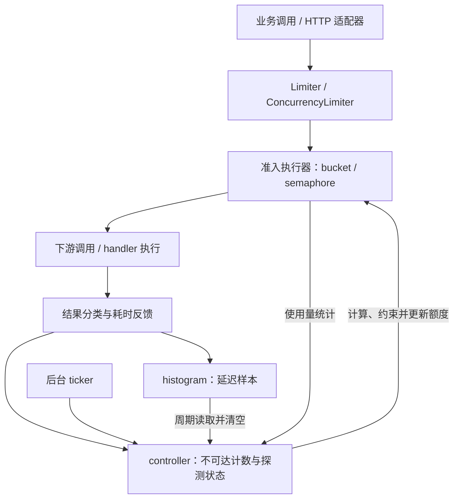

# 自适应速率与并发限制设计

本文描述 agilelimiter 的当前实现、组件边界及主要设计权衡。使用示例见 [README](../README.zh.md)；协议接入实现见 [httpclient](../httpclient/httpclient.go) 和 [httpserver](../httpserver/httpserver.go)。

## 1. 目标与适用范围

agilelimiter 根据延迟反馈，周期性调整请求准入额度，在配置边界内平衡处理量与延迟。

| 模式 | 对外类型 | 保护对象 | 额度单位 | 准入行为 |
|---|---|---|---|---|
| 出站限速 | `Limiter` | 下游依赖 | 请求数/秒 | 阻塞至放行时机 |
| 入站限并发 | `ConcurrencyLimiter` | 当前服务 | 同时执行的请求数 | 无可用名额时立即拒绝 |

两种模式共享控制器，分别使用漏桶和非阻塞信号量执行准入。速率限制约束请求的发送间隔；并发限制约束在途请求数，避免处理时间增加时持续积累并发。

作用范围为单进程。多个实例独立观测和调整额度，不协调全局配额。项目不提供分布式限流、入站等待队列或完全停止调用的熔断机制，也不保证严格的 SLO 达标比例。

## 2. 总体架构

### 2.1 组件职责与依赖

| 组件 | 实现 | 职责 |
|---|---|---|
| 协议适配器 | [httpclient/httpclient.go](../httpclient/httpclient.go)、[httpserver/httpserver.go](../httpserver/httpserver.go) | 执行准入、测量协议调用耗时，将响应或错误转换为观测结果 |
| 对外 API 与对象组装 | [limiter.go](../limiter.go)、[concurrency.go](../concurrency.go) | 处理配置，组装统计器、控制器与执行器，管理生命周期 |
| 统计器 | [histogram.go](../histogram.go) | 聚合耗时样本，输出周期分位数、样本数及超线数量 |
| 控制器 | [controller.go](../controller.go) | 维护基线与控制状态，计算并约束目标额度 |
| 出站执行器 | [bucket.go](../bucket.go) | 将目标速率转换为发送间隔，阻塞等待放行 |
| 入站执行器 | [semaphore.go](../semaphore.go) | 按目标并发数获取和释放名额，满额时非阻塞拒绝 |

协议适配器依赖根包提供的公共接口；核心控制器不依赖 HTTP 状态码或响应结构。`Limiter` 和 `ConcurrencyLimiter` 将执行器更新函数注入控制器，通过 `setRate func(int)` 应用新的额度。

`ConcurrencyConfig.toConfig()` 将并发边界映射为内部 `Config` 的速率字段，复用默认值、校验和控制算法。因此，并发模式下内部 `rate`、`Stats.Rate` 及 `Resolved` 的 `*Rate` 字段表示并发数量，而非请求速率。



### 2.2 请求路径

出站 `Limiter.Do()` 的执行顺序为：

1. 调用 `Take()`，等待漏桶放行。
2. 开始计时，同步执行一次业务调用。
3. 分类并反馈调用结果，返回业务错误。

入站 `ConcurrencyLimiter.Do()` 先尝试获取并发名额。失败时返回 `ErrOverloaded`，不执行回调；成功时计时、执行业务并反馈结果，通过 `defer` 释放名额。回调发生 panic 时仍会释放名额，但不会执行其后的结果反馈。

手动调用 `TryTake()` 时，每次成功获取必须对应且仅对应一次 `Release()`。HTTP 服务端适配器遵循同样的准入与释放规则；由限流器拒绝的请求不会作为 handler 耗时样本。

### 2.3 后台控制路径

`New()` 和 `NewConcurrency()` 只构造对象。`Start()` 启动后台 goroutine，由 `time.Ticker` 按 `Tick` 调用 `controller.step()`。请求路径负责准入和记录观测，后台路径负责汇总与决策，避免每次请求都执行控制计算。

## 3. 观测模型

### 3.1 耗时口径

控制器输入应表示被保护操作本身的耗时：出站测量实际调用开始至返回，入站测量被接纳请求的处理时间。出站等待准入的时间不得计入控制信号，否则降低速率产生的等待可能被误判为下游进一步变慢。

```go
started := time.Now() // 端到端指标的起点，应按应用需求选择
lim.Take()
sent := time.Now()
err := callDownstream()
finished := time.Now()

lim.ObserveOutcome(finished.Sub(sent), err) // 控制信号
endToEnd := finished.Sub(started)           // 包含本次准入等待
_ = endToEnd                               // 交由应用指标系统记录
```

`Take()` 返回安排的放行时刻，而非进入准入等待前的时间。从该返回值开始计时不包含完整的准入等待，也不能自动消除协调遗漏。固定 worker 被慢请求占满时，未发出的请求不会产生样本；若需评估按外部到达计划定义的延迟，应由应用或负载生成器独立记录到达计划和等待时间。

HTTP 客户端适配器测量底层 `RoundTrip()` 的执行时间，不包含后续响应体读取；服务端适配器测量 `ServeHTTP()` 至返回的时间。长连接、流式响应与普通短请求的耗时语义不同，应分别分配预算或定义观测策略。

每个样本应对应一次实际尝试。重试需逐次执行准入和反馈，避免把多次尝试总耗时作为单次调用耗时。缓存命中、健康检查、本地拒绝等不能代表目标资源处理能力的结果，应在反馈前分类；不同延迟分布的操作宜使用独立实例。

### 3.2 结果分类

`Outcome` 描述结果对控制器的意义，不等同于业务成功或失败。

| 结果 | 反馈行为 | 典型含义 |
|---|---|---|
| `Reached` | 清除探测状态，记录实际耗时 | 获得有意义的调用耗时，包括部分错误和超时 |
| `Unreachable` | 调用 `Unavailable()`，增加不可达计数并进入探测状态 | 连接失败、熔断打开，或适配器判定为不可服务 |
| `Aborted` | 通常不记录耗时 | 缓存命中、无效观测或调用方取消 |

通用 `Do()` 和 `ObserveOutcome()` 仅在错误非空时调用 `Config.Classify`。默认将 `context.Canceled` 判为 `Aborted`，其他结果判为 `Reached`，包括 `context.DeadlineExceeded`。自定义分类器可以覆盖默认错误分类。

取消请求的耗时是完整耗时的下界。`ObserveTruncated(d)` 仅在配置了 `SLOTarget` 且 `d > SLOTarget` 时记录该下界，避免丢弃已明确超线的慢请求；它不清除探测状态。通用路径对被分类为 `Aborted` 的取消错误执行此处理；HTTP 适配器则在自定义 `Verdict` 之前处理取消。

HTTP 适配器使用独立的 `Verdict`，通过 `WithVerdict` 定制，不经过 `Config.Classify`：

- 客户端默认将建连阶段的 `net.OpError`、HTTP 429 和全部 5xx 判为 `Unreachable`，将识别出的缓存命中判为 `Aborted`。
- 服务端默认将 HTTP 429、502、503、504 判为 `Unreachable`，其他 4xx 和缓存命中判为 `Aborted`；500 默认保留实际处理耗时。

这些策略属于适配层。核心控制器不负责推断具体错误或状态码是否代表容量不足。

### 3.3 周期统计与精度

`histogram` 使用固定大小的对数直方图，共 256 个桶，每个二倍区间划分为 4 个子桶。记录使用原子计数；快照逐桶读取并清零，计算 `p50`、`p99`、样本数 `n` 和尾延迟超线数量 `above`。它统计相邻快照之间的样本，不维护跨多个周期的滑动窗口。

分位数采用 nearest-rank，即 `ceil(q × n)`，返回目标桶的下界，因此存在向下量化误差，常规区间内约不超过 20%。尾部计数仅包含桶下界严格大于阈值的桶；包含阈值的桶不会计入，可能低估超线数量。

快照与记录可以并发进行，但逐桶交换不是全局原子快照，周期边界是近似的。这些统计适用于反馈控制，不应替代精确的 SLO 报表。

## 4. 控制算法

以下以 `R` 表示目标额度：出站单位为请求数/秒，入站单位为并发请求数。控制器内部保留浮点值，应用到执行器前四舍五入为整数。

### 4.1 周期处理顺序

`controller.step()` 在互斥锁内依次执行：

1. 根据不可达计数判断故障周期，必要时加入一条合成样本。
2. 读取并清空直方图和使用量统计，更新周期观测指标。
3. 样本数为零时返回，不调整额度；首次非空周期初始化基线后返回。
4. 更新延迟基线，计算控制窗口，根据中位数确定调整因子。
5. 应用尾延迟保护和故障回退，约束额度并更新执行器。

无样本周期不重置中位数迟滞计数，也不更新尾部比例平滑值。首次非空周期可能包含合成样本，初始化后同样不执行调速。

### 4.2 延迟基线

当前周期的 `p50` 直接作为主信号，`Stats.Fast` 保存该值，不另设快速 EWMA。基线 `B` 使用非对称指数加权移动平均：

```text
alpha(H) = 1 - 2^(-Tick / H)

p50 < B：
    B ← B + alpha(SlowDownHalfLife) × (p50 - B)
否则：
    delta ← min(alpha(SlowHalfLife) × (p50 - B), B × MaxBaselineRise)
    B ← B + delta
```

默认 `SlowHalfLife = 45s`，`SlowDownHalfLife = SlowHalfLife / 9`，`MaxBaselineRise = 0.002`。基线较快跟随改善，缓慢吸收持续变慢，限制拥塞对基线的抬升。基线不是历史最小值，也不提供主动重置或周期性降载探测接口。

### 4.3 控制窗口与锚点

窗口上界为 `high`，下界为 `low = high × (1 - Deadband)`，默认 `Deadband = 0.05`。

| 锚点 | 窗口上界 |
|---|---|
| `AnchorBaseline`，无 SLO | `B × (1 + TargetInflation)` |
| `AnchorBaseline`，有 SLO | `min(B × (1 + TargetInflation), 0.8 × SLOTarget)` |
| `AnchorSLO`，有 SLO | `0.8 × SLOTarget` |

基线锚点根据相对延迟变化回退，不需要 SLO，但可能将网络路径变化等外部原因造成的持续变慢判断为拥塞。SLO 锚点允许延迟在固定目标窗口内变化，但不会识别低于该窗口的容量拐点。SLO 锚点下仍维护基线，用于可观测性和故障合成样本。

请求 `AnchorSLO` 却未提供 `SLOTarget` 时，运行逻辑回退为基线锚点；`Validate()` 可报告此配置问题，`Config()` 会显示实际回退情况。

### 4.4 中位数决策、冷启动与使用量约束

| 条件 | 行为 |
|---|---|
| `p50 >= high` | 增加高延迟计数，清零低延迟计数；达到 `BackoffTicks` 时令调整因子为 `1 - DownStep` |
| `p50 <= low` | 增加低延迟计数，清零高延迟计数；达到 `RecoverTicks` 时检查使用量并尝试增长 |
| `low < p50 < high` | 清零两侧计数，保持额度 |

一次对应动作后清零该侧计数。计数针对有样本周期；无样本周期的处理见 §4.1。默认基线锚点的 `BackoffTicks/RecoverTicks` 为 `1/1`，有效 SLO 锚点为 `2/2`，preset 或显式配置可覆盖这些值。

满足增长条件时，先检查使用量。已知使用量且 `Used × 2 < R` 时保持额度，避免在缺乏流量验证的情况下持续提高准入上限：

- 出站使用量为本周期进入 `Take()` 的调用次数除以 `Tick`，包含尚在等待放行的调用。
- 入站使用量为周期内在途请求峰值；新周期以当前在途数量为起点，跨周期请求继续计入。
- 未统计到使用量时视为未知，不阻止增长，例如仅调用 `Observe()` 的路径。

允许增长时，冷启动阶段使用 `SlowStartGain`，默认乘以 2；之后使用 `1 + UpStep`，默认乘以 1.05。首次中位数回退、尾部回退、故障回退，或达到最大额度后结束冷启动；恢复阶段不重新启用冷启动。`SlowStartGain = 1` 可关闭倍增增长。

正常增长和回退均按当前额度的比例计算，不是固定数量的加性增长。默认回退因子为 `1 - DownStep = 0.70`，不存在独立的对称单周期变化限制。

### 4.5 尾延迟保护

配置 `SLOTarget` 后启用尾延迟保护，阈值为 `T = SLOTarget × TailFactor`，默认 `TailFactor = 1`。它不改变中位数窗口，只调整尾部判定阈值。

解析后的 `TailTolerance = 0` 时，使用分位数模式：`p99 > T` 触发回退。`TailTolerance > 0` 时使用比例模式，记容忍比例为 `tol`：

```text
alpha = 1 - 2^(-1/2)                      // 半衰期为两个 Tick
ratio = above / n
smoothed ← smoothed + alpha × (ratio - smoothed)
sigma = sqrt(tol × (1 - tol) / n) × sqrt(alpha / (2 - alpha))
threshold = tol + 3 × sigma

触发条件：smoothed > threshold 且 ratio > tol
```

统计余量根据当前样本量估算：样本较少时阈值更宽，以降低采样波动造成的回退；当前比例条件避免仅因平滑值仍高而持续回退。该近似统计判据不是长窗口 SLO 达标保证。

尾延迟保护和故障回退不等待 `BackoffTicks`。触发时将调整因子限制为不高于 `1 - DownStep`；多个回退条件不会重复相乘。

## 5. 故障与恢复

### 5.1 故障判定与合成样本

`Unavailable()` 增加不可达计数并立即设置探测状态，不直接修改额度。控制周期开始时，若存在不可达记录且其数量不小于当时 `hist.total` 的两倍，控制器尝试构造合成样本，并将本周期标记为故障周期。两类计数的并发读取属于周期近似，不是严格同步的业务错误率统计。

合成耗时的构造规则为：

- 有 SLO：`1.5 × max(SLOTarget, B)`。
- 无 SLO 且基线已初始化：`1.5 × B × (1 + TargetInflation)`。
- 无 SLO 且基线未初始化：无法构造样本，不执行故障回退。

每个故障周期最多加入一条合成样本，并直接应用回退因子。该样本用于保持故障期间的控制输入，不表示一次真实延迟，也不用于按不可达次数扩大尾部超线比例。仅有少量不可达调用时，不加入合成样本、不强制故障回退。

### 5.2 地板切换与额度约束

正常状态使用 `FloorRate`，探测状态使用 `ProbeRate`；并发模式对应 `FloorLimit` 和 `ProbeLimit`。控制更新最终执行：

```text
floor = probe ? ProbeRate : FloorRate
R ← clamp(R × factor, floor, MaxRate)
```

普通 `Observe()` 或 `Reached` 结果清除探测状态，后续控制更新恢复正常地板约束。`Aborted` 和 `ObserveTruncated()` 不清除探测状态。地板切换不会立即修改执行器；故障判定与当前探测状态分别决定是否回退和采用哪个下界。

默认故障探测额度至少为 1，因此仍保留恢复观测机会。正常地板是调用方对安全容量的判断，持续超时但未被判定为不可达时，控制器仍受正常地板限制；真实容量低于该地板时，限流器无法继续下调。

## 6. 配置与运行机制

### 6.1 配置解析

构造过程先执行 `applyPreset()`，再由 `withDefaults()` 补全默认值并修正部分冲突。下表为未覆盖字段的策略：

| Preset | 锚点 | BackoffTicks / RecoverTicks | TargetInflation | TailTolerance |
|---|---|---|---|---|
| `PresetNone`，无 SLO | 基线 | 1 / 1 | 1.0 | 0，尾部保护关闭 |
| `PresetNone`，有 SLO | SLO | 2 / 2 | 1.0 | 0.05 |
| `PresetBalanced` | 基线 | 1 / 1 | 1.0 | 0，分位数模式 |
| `PresetLatencyFirst` | SLO | 2 / 2 | 1.0 | 0，分位数模式 |
| `PresetThroughputFirst` | 基线 | 2 / 1 | 2.5 | 0，分位数模式 |

尾部保护始终要求 `SLOTarget > 0`。preset 根据各字段的未设置判据填值；正的显式调参值及显式锚点优先，零值通常表示使用默认值。例如，`PresetNone` 配合 SLO 时，`TailTolerance = 0` 会解析为 0.05，不能据此强制选择分位数模式。

边界配置中，`MinRate` 默认为 1；未指定的 `FloorRate` 和 `ProbeRate` 继承 `MinRate`。`InitialRate` 默认取整数 `MaxRate / 8`，再约束到正常地板与最大值之间。默认 `Tick = 1s`；其他控制参数见 §4。并发配置遵循相同解析规则。

`New()` 不自动调用 `Validate()`，也不返回配置错误；严格配置检查需要调用方在构造前显式执行。部分冲突会改变生效上限，例如 `MaxRate = 100, FloorRate = 200` 会使生效 `MaxRate` 被抬升为 200。应通过 `Config()` 返回的 `Resolved` 检查最终配置、窗口和尾部策略。

### 6.2 执行器与并发边界

漏桶以 `1s / rate` 计算放行间隔。首次调用立即放行；后续基于上次放行时间安排下一次放行，空闲后对齐当前时间，不累计突发额度。速率更新只改变后续读取的间隔，不重置已有时间状态，也不中断当前等待。

信号量通过原子比较交换获取名额，通过原子减法释放。下调并发上限不会取消已接纳请求；当前在途数量可能暂时高于新上限，后续准入等待在途请求自然下降后恢复。

控制器以互斥锁保护状态更新和统计读取；直方图、使用量计数及信号量使用原子操作。漏桶在互斥锁内执行等待，`Observe()` 也会获取控制器锁以清除探测状态，因此整个请求路径并非无锁。零分配性质由相应测试验证，不等同于无锁或无阻塞。

最大额度约束位于控制器。`bucket.setRate()` 和 `semaphore.setLimit()` 仅兜底最小值为 1，不独立保存或校验配置上限。因此当前实现不具备执行器层的第二重最大值保护；约束针对解析后的配置，不应描述为任何配置下都保持调用方原始上限。

### 6.3 生命周期与可观测性

`Start()` 和 `Stop()` 分别通过 `sync.Once` 保证重复调用不会重复启动循环或关闭停止通道。`Stop()` 等待后台循环退出；实例停止后不能重新启动，也不会取消已接纳的业务请求或中断 `Take()` 的等待。生命周期调用应由所属服务统一管理。

`Clock` 控制核心调用计时和漏桶等待；后台 ticker 仍使用真实时间。虚拟时钟测试通过直接执行控制步骤驱动演进，不依赖替换后台 ticker。

关键观测字段为：

| 接口或字段 | 含义 |
|---|---|
| `Rate()` / `Limit()`、`InFlight()` | 当前目标速率或执行器并发上限，以及实际在途数量；`Rate()` 可能含小数 |
| `Stats.Samples`、`P50`、`P99` | 最近一次控制步骤读取的样本数及近似分位数；故障周期可能包含合成样本 |
| `Stats.Baseline`、`Fast` | 平滑基线与最近非空周期的中位数 |
| `Stats.TailRatio`、`TailThreshold` | 比例模式下的平滑超线比例与触发阈值 |
| `Stats.ColdStart`、`Used` | 冷启动状态与最近周期使用量 |
| `Config()` | 解析后的边界、控制参数和实际策略 |

无样本周期的 `Samples/P50/P99` 为零，但基线和部分控制状态保留。持续无样本表示缺乏调整依据，不能仅凭额度不变判断系统稳定。HTTP `StatsHandler` 提供部分状态的 JSON 输出，应挂载在准入中间件之外，以便过载时访问。

## 7. 设计权衡与已知限制

| 设计决策 | 技术依据 | 代价或边界 |
|---|---|---|
| 共享控制器、独立执行器 | 两种模式都可将延迟反馈转换为标量额度更新 | 保护对象、额度单位和使用量含义不同，配置不可直接照搬 |
| 入站非阻塞准入 | 避免过载请求在限流器内等待并持有资源 | 调用方需处理拒绝，HTTP 默认返回 429 |
| 基线非对称更新与上升限幅 | 限制持续拥塞抬升相对窗口 | 真正的长期延迟变化需要更长时间吸收 |
| 冷启动倍增、恢复按小比例增长 | 缩短初始探索，同时减少恢复阶段再次过冲 | 深度回退后的恢复可能较慢 |
| 比例式尾部保护 | 容忍少量固定慢请求，降低单周期分位数波动的影响 | 快样本过多会稀释超线比例；低样本量下统计余量较大 |
| 结果分类位于接入边界 | 只有业务和协议层能判断样本是否代表资源处理能力 | 默认策略不能覆盖所有缓存、降级和重试语义 |

延迟不能单独区分排队、网络变化、固定慢操作和本地开销。实例划分与样本分类直接影响控制效果；尾部容忍度也不能替代对无效快样本的过滤。

控制按周期执行，存在采样和反馈滞后。修改 `Tick` 同时改变单位时间内的调节次数及按周期定义的基线上升限制，应结合增长、回退与半衰期参数验证。当前 `Take()` 不接收 context，等待不能因请求取消而提前结束；流式调用、全局配额及完全停止探测需要另行处理。

## 8. 验证与维护入口

| 验证内容 | 代码入口 |
|---|---|
| 放行节拍、速率变化、增长与回退 | [limiter_test.go](../limiter_test.go)、[concurrency_test.go](../concurrency_test.go) |
| 锚点、迟滞、冷启动与配置解析 | [anchor_test.go](../anchor_test.go)、[slowstart_test.go](../slowstart_test.go)、[config_test.go](../config_test.go) |
| 故障、取消、地板切换与恢复 | [outage_test.go](../outage_test.go)、[refused_diag_test.go](../refused_diag_test.go)、[floor_probe_test.go](../floor_probe_test.go)、[concurrency_probe_test.go](../concurrency_probe_test.go) |
| 随机输入下的边界约束与统计精度 | [properties_test.go](../properties_test.go) |
| 协议分类、准入拒绝与资源释放 | [httpclient/httpclient_test.go](../httpclient/httpclient_test.go)、[httpserver/httpserver_test.go](../httpserver/httpserver_test.go) |
| 生命周期与统计输出 | [observability_test.go](../observability_test.go) |
| 热路径分配与基准 | [bench_test.go](../bench_test.go)、两个 HTTP 包的基准测试 |
| 容量变化、样本污染和混合流量 | [sim/](../sim/) |

核心测试使用自定义假时钟，并直接驱动控制步骤；`sim/` 通过内部 [simhook](../internal/simhook/simhook.go) 驱动控制器并注入模型使用量，无需等待模拟时间实际流逝。主模块仅依赖 Go 标准库。

在仓库根目录运行：

```bash
go test ./...                    # 主模块完整测试
go test -short ./...             # 跳过部分长时间仿真
go test -race ./...               # 竞态检测，长仿真耗时更高
go test -run '^TestAdvantage' -v ./sim
```

[compare/](../compare/) 是独立 Go 模块，包含真实时钟对照实验和诊断测试，不由根目录的 `go test ./...` 覆盖。历史结果见 [RESULTS.md](../compare/RESULTS.md) 和 [ADVANTAGE.md](../compare/ADVANTAGE.md)；其中部分数据来自旧控制器版本，不能直接视为当前实现的性能保证。评估控制策略时应记录版本、模型、配置及测量口径，并同时关注 SLO 内完成量（goodput）、过载持续时间和恢复时间。
